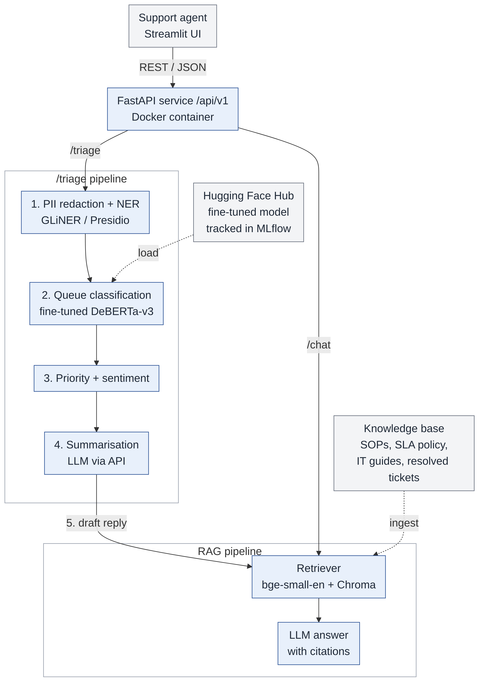

# AI Service Desk Copilot

An API-based NLP application for customer-support and IT service-desk teams. It triages incoming tickets and answers agents' questions from a company knowledge base.

**AIMLZG549 API-driven Cloud Native Solutions, Assignment II, Group 60**
Prashob N (2025AE05006) · Radhakrishnan R (2025AF05003) · Swami Vivek Bakal (2025AF05121)



## What it does

| # | Sub-task | Model | Endpoint |
|---|---|---|---|
| 1 | PII redaction + named-entity recognition | Regex recognisers + GLiNER (`urchade/gliner_multi_pii-v1`) | `POST /api/v1/redact` |
| 2 | Queue classification (routing) | **Fine-tuned** `microsoft/deberta-v3-base` | `POST /api/v1/classify` |
| 3 | Priority + customer sentiment | **Fine-tuned** priority classifier + `cardiffnlp/twitter-roberta-base-sentiment-latest` | `POST /api/v1/priority` |
| 4 | Summarisation | LLM via API (gpt-oss-20b on Groq's free tier, or OpenAI), on redacted text | `POST /api/v1/summarise` |
| 5 | Grounded reply drafting and Q&A (RAG) | `BAAI/bge-small-en-v1.5` + Chroma + LLM | `POST /api/v1/chat` |
| — | Whole pipeline in one call | all of the above | `POST /api/v1/triage` |

Personal data is masked **before** any text reaches the external LLM. Low-confidence routing (below 50%) is flagged for a human. The chatbot answers only from retrieved passages, cites them as [1], [2], and returns a "not covered" reply when nothing relevant is found.

## Repository layout

```
app/            FastAPI service: config, schemas, error handling, services (redact, priority, summarise, triage)
classifier/     Part II: train.py (fine-tuning + MLflow), baselines.py, compare.py, predict.py (inference)
rag/            Part III: pipeline.py (RAGPipeline), ingest.py, docs/ (knowledge base), eval/ (evaluation)
ui/             Streamlit front-end and sample tickets
data/           prepare.py: download, clean, split, EDA charts
notebooks/      colab_finetune.ipynb: runs all of Part II on a free Colab GPU
scripts/        benchmark_triage.py (latency table), docker entrypoint, notebook generator
tests/          23 offline tests (API, redaction, RAG, LLM config)
reports/        generated metrics (JSON/Markdown) and figures for the report
```

## Quick start (local, Python 3.11)

```bash
python -m venv .venv && source .venv/bin/activate      # Windows: .venv\Scripts\activate
pip install -r requirements-dev.txt
cp .env.example .env                                    # add GROQ_API_KEY (free), set the model IDs
python -m pytest                                        # 23 tests, about 2 seconds, no internet needed
```

### 1. Fine-tune the models (Part II): Google Colab, about 1 hour

Open `notebooks/colab_finetune.ipynb` in Colab with a T4 GPU and run all cells. The notebook:

1. Prepares the data (`python -m data.prepare`): English tickets, deduplicated, 80/10/10 split stratified by queue.
2. Runs the baselines (`python -m classifier.baselines --label queue --zero-shot`).
3. Fine-tunes the queue and priority classifiers (`python -m classifier.train --label queue|priority --push-to-hub ...`), logged to MLflow.
4. Builds the comparison tables (`python -m classifier.compare`) and downloads `part2_results.zip`.

Then put the Hub repo IDs in `.env`:

```
CLASSIFIER_MODEL_ID=<hf-user>/servicedesk-queue-classifier
PRIORITY_MODEL_ID=<hf-user>/servicedesk-priority-classifier
```

If there's no priority model yet, the app falls back to LLM-based priority, so it still runs.

### 2. Build the knowledge-base index (Part III)

```bash
python -m rag.ingest                                                    # policies and SOPs only
python -m rag.ingest --tickets data/processed/kb_tickets.csv --reset    # + 2,000 past resolved tickets
```

Optional: put public PDFs (for example NIST SP 800-61) in `rag/docs/public/`; PDFs are indexed too.

### 3. Run the API and the UI

```bash
uvicorn app.main:app --reload            # http://localhost:8000/docs  (Swagger)
streamlit run ui/streamlit_app.py        # http://localhost:8501
```

The first request to each model downloads it from Hugging Face, which takes a few minutes once. Set `PRELOAD_MODELS=true` to do this at start-up.

### 4. Or run everything with Docker

```bash
docker compose up --build                # API on :8000, UI on :8501; the index is built on first start
```

## LLM provider

The LLM is reached through the OpenAI-compatible chat API, so the provider is one setting:

| `LLM_PROVIDER` | Key | Default model | Notes |
|---|---|---|---|
| `groq` (default) | `GROQ_API_KEY`, free at console.groq.com/keys | `openai/gpt-oss-20b` | No card needed; free-tier rate limits apply per model; the client waits and retries automatically, and the evaluation judge uses openai/gpt-oss-120b so it draws on a separate quota |
| `openai` | `OPENAI_API_KEY` | `gpt-4o-mini` | Paid; faster for bulk evaluation |

Set `LLM_MODEL` to use another model from the same provider.

## Evaluation

| What | Command | Output |
|---|---|---|
| Classifier vs baselines | Colab notebook | `reports/metrics/comparison_queue.md`, confusion matrices, training curves |
| RAG quality (faithfulness, answer relevancy, context precision, hit rate, refusals) | `python -m rag.eval.run_eval` | `reports/metrics/rag_eval.json`, `rag_eval_details.csv` |
| RAG threshold calibration (no API cost) | `python -m rag.eval.run_eval --retrieval-only` | suggested `RAG_SCORE_THRESHOLD` |
| Latency per pipeline step | `python scripts/benchmark_triage.py` (API running) | `reports/metrics/latency.md` |
| MLflow runs | `mlflow ui --backend-store-uri sqlite:///mlflow.db` | http://localhost:5000 |

The RAG metrics follow the RAGAS definitions but are implemented directly with an LLM judge, because `ragas` 0.4.3 fails to import with current `langchain-community` releases.

## API summary

All endpoints are under `/api/v1`. Every response carries `meta` (request ID, model, latency), and every error uses one format: `{"error": {"code", "message", "request_id"}}`. Status codes are 400, 401, 413, 422, 429, 500, 503 and 504. Set `API_KEY` to require an `X-API-Key` header.

```bash
curl -s localhost:8000/api/v1/triage -H 'Content-Type: application/json' -d '{
  "subject": "VPN disconnects every few minutes",
  "body": "Since the update the VPN drops every 5 minutes for our whole finance team. Call me on +971 50 123 4567."
}' | python -m json.tool
```

## Data and licences

- Tickets: [Tobi-Bueck/customer-support-tickets](https://huggingface.co/datasets/Tobi-Bueck/customer-support-tickets), CC BY-NC 4.0, used for non-commercial academic work.
- Knowledge base: `rag/docs/` holds policies and SOPs written by the group for a fictional company, TechServ Ltd (see `rag/sources.csv`).
- The service catalogue lists 10 queues. If your dataset release has a different set, the app always uses the labels stored in the fine-tuned model (`label_map.json`).
